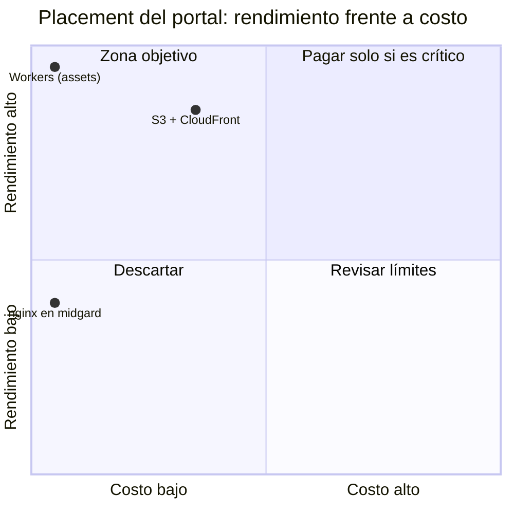

# ADR-0035: El portal se sirve como assets estáticos en Cloudflare Workers, desplegado desde GitHub Actions

- **Estado:** accepted
- **Fecha:** 2026-10-15
- **Decisores:** Jeremi Alcalá
- **Fase AI-DLC:** 02-design
- **Origen:** plan del portal, PR 0.1 y 1.4
  (`docs/03-implementation/portal-publico-implementacion.md`); decisión D12
- **Controles OWASP afectados:** A05 (cabeceras y CSP del sitio) / A08
  (procedencia de la herramienta que despliega)

## Contexto

El portal (`apps/portal`, ADR-0031) es un sitio estático: el build pinta el HTML
de cada ruta (prerender, RNF-4) y el navegador lo hidrata. Los datos en vivo no
salen del sitio, sino del gateway: `GET /portal/v1/snapshot` y
`/dashboard/series` (ADR-0028), por sondeo.

Perfil de carga A de la guía de placement: estático puro, sin estado ni
backend propio. Tráfico esperado a 12 meses: bajo y con picos cuando la brecha
se mueve, con la mayoría de los visitantes en Venezuela, a menudo por móvil.

Dos restricciones:

- **Tiene que sobrevivir a midgard.** El núcleo corre en `hgtech001`, con un
  disco que falla, sin UPS y con apagones (ADR-0034). Si el sitio viviera ahí,
  una caída se llevaría también la página que explica qué es Criterio. Con el
  sitio fuera, una caída deja el portal en pie diciendo «sin conexión» con el
  último dato.
- **El bundle y su CSP tienen que salir del mismo valor.** El portal lee el
  gateway desde otro origen (`VITE_PORTAL_API`). Es la regla del `web-spa`: si
  el origen del código y el de `connect-src` divergen, el navegador bloquea el
  sondeo con la cabecera aparentemente bien escrita.

**D12 (2026-10-14):** el portal se publica en `criterio.higerotech.com`, el
dominio del diseño. Mientras D15 siga abierta, lee del gateway de midgard
(`criterio-api-dev.higerotech.com`). Cambiarlo es una variable del workflow y
un nuevo despliegue, no código.

## Candidatos evaluados

Precios verificados en la documentación de Cloudflare el 2026-10-15: página de
precios de Workers (actualizada el 2026-10-02), límites de la plataforma
(2026-10-12) y facturación de static assets (2026-04-23).

- **Workers, assets estáticos sin script:** las peticiones a assets son
  gratuitas e ilimitadas en los dos planes. El plan gratuito permite 20.000
  ficheros por versión, de hasta 25 MiB cada uno; el portal tiene 23.
- **nginx en midgard tras el túnel,** como el `web-spa`: $0 de más, pero con el
  disco y la luz de midgard (ADR-0034).
- **Cloudflare Pages:** la oferta de assets de Workers la sustituye para
  proyectos nuevos, con las mismas cabeceras (`_headers`) y sin ventaja aquí.
- **S3 + CloudFront:** unos pocos dólares al mes y un proveedor más. La cuenta
  de AWS sigue sin abrir (D15).

| Criterio (peso) | Workers (assets) | nginx en midgard | S3 + CloudFront |
|---|---|---|---|
| Latencia (30 %) | 5: borde de Cloudflare | 3: un origen, con caché en el borde solo si se configura | 5 |
| Escalabilidad (20 %) | 5 | 3 | 5 |
| Disponibilidad (15 %) | 5: independiente de midgard | 1: cae con midgard | 5 |
| Límites técnicos (15 %) | 4: `_headers` limitado a 100 reglas | 5 | 4 |
| Carga operativa (20 %) | 5: sin servidor; versiones y vuelta atrás incluidas | 3: imagen, compose y receptor | 3: IAM, bucket y distribución |
| **Score_perf** | **4,85** | **3,00** | **4,45** |
| **Costo USD/mes** | **$0** | $0 de más | ≈ $1–3 |

## Decisión

### 1. Workers con assets y sin script

`apps/portal/wrangler.jsonc` declara solo `assets`, sin `main`. Así no se
ejecuta código en el borde: cada petición es a un asset, gratis, y `_headers`
se aplica a todas las respuestas. Si algún día hace falta un script, sus
respuestas no heredarán `_headers` y la CSP tendrá que ir en el código.

- `html_handling: "drop-trailing-slash"`: `/precios` sirve
  `dist/precios/index.html`, y `/precios/` redirige a `/precios`. Las URLs
  coinciden con las del router y con los enlaces.
- `not_found_handling: "404-page"`: cualquier otra ruta recibe `dist/404.html`
  con estado 404. El prerender lo pinta con la página «no existe» y
  `noindex`, y al hidratar el router pinta lo mismo.
- **Dominio propio** (`routes` con `custom_domain`): Workers crea el registro
  DNS y el certificado. `workers_dev` y `preview_urls` quedan apagados: serían
  orígenes que el gateway no acepta en CORS.

### 2. Cabeceras desde el mismo input que el bundle

`src/cabeceras.ts` genera `_headers` y el prerender lo escribe con el
`VITE_PORTAL_API` que vio Vite (`loadEnv`). Un origen que no sea `https://host`
sin ruta rompe el build.

- **CSP:** `script-src 'self'` y `style-src 'self'`, sin nada en línea.
  `style-src-attr 'unsafe-inline'` porque los componentes de `@criterio/ui`
  pintan con atributos `style` y el HTML prerenderizado los lleva. Además,
  `connect-src` con el gateway, `frame-ancestors 'none'`, `object-src 'none'` y
  `base-uri`/`form-action 'self'`. Desde la página APIs (plan 3.4), el origen
  del gateway va en `connect-src` también como `wss://`, para que el playground
  pruebe `/ws/v1`; el humo de `deploy-portal.yml` comprueba los dos.
- `nosniff`, `Referrer-Policy`, `Permissions-Policy` y HSTS en todo; `/assets/*`
  inmutable (Vite pone el hash en el nombre). El HTML conserva el
  `max-age=0, must-revalidate` de Workers.

### 3. CD con GitHub Actions, no con Workers Builds

`.github/workflows/deploy-portal.yml` despliega en cada push a `main` que toque
el portal, el paquete compartido, el workspace o el wrangler fijado. La guía
reserva Workers Builds para componentes que viven enteros en Cloudflare, y
aquí no se cumple:

- el portal vive en un monorepo con tests, contrato y prerender;
- el valor de `VITE_PORTAL_API` es del entorno, igual que en `build-web-spa`.

El workflow construye y comprueba que el bundle y la CSP llevan el mismo
gateway. Después despliega con la etiqueta `sha-xxxxxxx` y hace una prueba de
humo contra el dominio: el HTML, la CSP, una ruta, el 404 y el CORS del
gateway para el origen del portal.

Secretos: `CLOUDFLARE_API_TOKEN`, con la plantilla «Edit Cloudflare Workers»
limitada a la cuenta y a la zona `higerotech.com`, y `CLOUDFLARE_ACCOUNT_ID`.

### 4. Wrangler fijado, fuera del workspace y auditado

`deploy/portal/` tiene su `package.json` con `wrangler` exacto y su lockfile.
Va fuera del workspace a propósito: su árbol (workerd, esbuild, miniflare) no
entra en cada `npm ci` del CI. Lo audita T8 (`seguridad.yml`). El despliegue lo
instala con `--ignore-scripts`, porque subir assets no necesita los binarios.

La versión es la **4.149.0** (2026-10-08). La primera candidata, la 4.144.0,
la paró el auditor: arrastra `sharp` < 0.35.5 (GHSA-wq5f-xc86-pv6w, en
`librsvg`). En vez de aceptar el riesgo por escrito, se fijó la primera versión
con el arreglo.

### 5. CORS del gateway

El origen `https://criterio.higerotech.com` se añade a `ALLOWED_ORIGINS`
(plan 2.5). En midgard ese valor pasa del `.env` al compose versionado
(`deploy/midgard/api-gateway/docker-compose.yml`): no es un secreto, y así
cada cambio pasa por un PR.

## Consecuencias

**Positivas:**

- $0 al mes y servido desde el borde. El sitio no cae con midgard.
- Cada versión queda en Workers: volver atrás es `wrangler rollback` o un clic
  en el panel, sin pasar por el receptor.
- La CSP ya no puede divergir del bundle sin que falle el build.

**Negativas:**

- Un proveedor más en el camino de despliegue (cuenta, token, zona). Es el
  mismo Cloudflare que ya sirve el túnel y el DNS.
- Sin previews por PR (decisión del 2026-10-14): cada preview sería un origen
  distinto en `workers.dev` y el gateway tendría que aceptarlos por patrón.
- `style-src-attr 'unsafe-inline'` es una concesión. Los atributos `style` no
  ejecutan código, pero una inyección de HTML podría usarlos para maquillar la
  página.

**Lock-in aceptado:** la configuración (`wrangler.jsonc`, `_headers`) es de
Cloudflare. El sitio es HTML y JS estáticos: moverlo a otro CDN supone
reescribir dos ficheros, no el portal.

**Condiciones de revisión:**

- si el portal necesita lógica en el borde (un script), revisar la CSP: ya no
  vendría de `_headers`;
- si Cloudflare empieza a cobrar las peticiones a assets;
- al decidir D15: cambiar `PORTAL_API` en el workflow y el compose del gateway
  de producción.

## Verificación

- `apps/portal/tests/unit/cabeceras.test.ts`: `connect-src` lleva exactamente
  el origen; nada `unsafe` salvo `style-src-attr`; un origen mal escrito rompe
  el build; la página 404.
- `apps/api-gateway/tests/unit/test_cors.py`: el portal lee `/portal/v1` y el
  `Retry-After` de un 429; orígenes parecidos (otro esquema, sufijo, otro
  subdominio) no reciben `Access-Control-Allow-Origin`.
- CI: `wrangler deploy --dry-run` en el job `portal` de cada PR.
- Despliegue: la prueba de humo de `deploy-portal.yml`.
- Comprobado a mano el 2026-10-15 con `wrangler dev --port 8080` contra el
  gateway de midgard:
  - las rutas responden 200, `/precios/` da 307 a `/precios` y una ruta
    desconocida, 404 con la página propia;
  - las cabeceras salen en todo y `/assets` es inmutable;
  - en Chrome, cero violaciones de CSP y el sondeo trae el snapshot por CORS.
