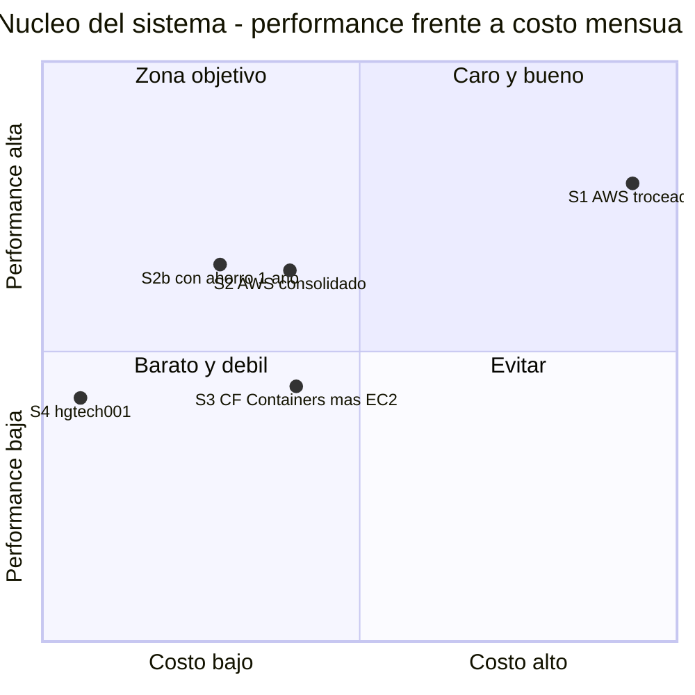

# Placement del despliegue completo — AWS frente a Cloudflare (costo/performance)

- **Estado:** review — análisis para decisión HITL
- **Fecha:** 2026-10-05 · **revisado el 2026-11-21**: precios oficiales,
  carga medida, Lambda (S5) y `hgtech002` (S4b)
- **Decisores:** Jeremi Alcalá
- **Fase AI-DLC:** 02-design
- **Versión:** Unreleased
- **Método:** guía de *deployment placement* del AI-DLC (clasificación por
  perfil, árbol de decisión, matriz PxD con pesos por defecto y precios
  verificados con fecha)

## Resumen

1. **Cloudflare no puede alojar el núcleo del sistema.** Sus Containers no
   tienen disco persistente («all disk is ephemeral by default»), se duermen
   tras 10 minutos sin actividad y siguen en beta. TimescaleDB y RabbitMQ
   necesitan disco que sobreviva a un reinicio. No hay escenario «todo en
   Cloudflare»: el que más se acerca deja la base y el bus fuera, y paga
   latencia y egress por cruzar de proveedor en cada consulta.
2. **Cloudflare sí gana el borde, con mucha diferencia:**
   - el portal, el `web-spa` y la UI del backoffice como estáticos en Workers,
     a $0;
   - DNS, túnel, caché, Access y Turnstile.

   Vale en todos los escenarios.
3. **Para el núcleo, entre las opciones en la nube, gana AWS con una sola
   instancia EC2 `t4g.large`**, que corre el mismo `docker compose` que hoy
   detrás de Cloudflare Tunnel: **$62,76 al mes, o $44,51 con ahorro a un año.**
   Su PxD (0,51, o 0,72 con ahorro) **duplica** el de la arquitectura AWS
   «troceada» (Fargate + Amazon MQ + ALB: $149,53 y PxD 0,26), y supera al
   híbrido con Cloudflare Containers (0,35).
4. **`hgtech001` sigue siendo lo más barato,** pero con el peor puntaje de
   disponibilidad. La decisión de fondo no es AWS o Cloudflare: es **cuándo
   pasa el núcleo de `hgtech001` a AWS**. La recomendación es **antes de vender
   SLA**, es decir, antes del hito M4 (nivel Empresa).
5. **Revisión del 2026-11-21** ([sección propia](#revisión-del-2026-11-21)):
   - **S2 se confirma con precios oficiales:** $63,70 al mes, o $45,38 con
     ahorro a un año. Sube 94 centavos porque el full diario creció.
   - **Lambda (S5) no abarata:** la base sigue en una EC2 siempre encendida y
     Lambda le suma NAT, bus y API Gateway. En el mejor caso ahorra $4 al mes con
     ahorro a un año, a cambio de reescribir el WSS, el bus y el CD.
   - **`hgtech002` (S4b) es mejor máquina que `hgtech001`,** con SSD y el triple
     de TPS, pero comparte con ella la luz y la salida a internet: 98,3 % de
     disponibilidad medida. La recomendación pasa a **AWS desde el principio**.

## Carga real (medida el 2026-10-05, no estimada)

En la máquina de desarrollo, que corre el stack completo:

| Servicio | CPU | Memoria | Nota |
|---|---|---|---|
| `timescaledb` | 2,2 % | **4,2 GiB** | la única carga real |
| `rabbitmq` | 0,1 % | 118 MiB | |
| `api-gateway` | 0,2 % | 74 MiB | |
| `ingestor-binance` | ~0 % | 51 MiB | sondea Binance cada 60 s |
| `ingestor-bcv` | ~0 % | 54 MiB | cada 30 min |
| `indicator-engine` | ~0 % | 28 MiB | reactivo al bus |
| `respaldo` | ~0 % | 38 MiB | `pg_dump` diario de ~27 min |

- **Base de datos: 10 GB, y estable.** 9,5 GB son `p2p_snapshots_raw`, con
  retención de 90 días. Sus datos van del 2026-07-06 al 2026-10-05: **la
  ventana ya está llena** y la retención está borrando lo viejo. El full pasó
  de 2,3 GB a 4,9 GB mientras se llenaba, y desde aquí debería estabilizarse en
  torno a 5 GB. Las proyecciones a 12 meses usan **10–15 GB de base**.
- **Egress:** ~5 GB al día de respaldos a B2, unos **150 GB al mes**. Más las
  respuestas de la API, estimadas en 10 GB al mes. En AWS, el egress a internet
  se cobra pasados los primeros 100 GB del mes.

## Clasificación por componente

| Componente | Perfil | Árbol de la guía | Dónde puede vivir |
|---|---|---|---|
| Portal, `web-spa`, UI del backoffice | **A — estático** | Workers static assets | Cloudflare (decidido para el portal el 2026-10-05) |
| `api-gateway` (FastAPI, WSS, AMQP, asyncpg) | **C — API con conexiones persistentes** | ECS Fargate o EC2 | AWS, `hgtech001`, o Cloudflare Containers con reservas |
| `ingestor-binance`, `indicator-engine`, `estado`, `backoffice-api` | **D — worker continuo 24/7** | ECS o EC2 | ídem |
| `ingestor-bcv`, `respaldo` | **D — programado** | tareas bajo demanda | ídem |
| **TimescaleDB** | **E — especial** (extensión con licencia, disco persistente) | ADR dedicada | **EC2, `hgtech001` o Tiger Cloud.** **RDS no ofrece la extensión `timescaledb`**, verificado en la lista oficial de extensiones de RDS para PostgreSQL 16 y 17. **Cloudflare no puede**: sin disco persistente |
| **RabbitMQ** | **D/E** (estado en disco) | Amazon MQ o EC2 | Amazon MQ, EC2 o `hgtech001`. **No en Cloudflare**: Queues no habla AMQP, y adoptarlo es reescribir el bus |

## Escenarios evaluados

En todos, el **borde es Cloudflare**: portal en Workers, túnel, DNS, caché y
Access. Lo que cambia es **dónde vive el núcleo**. Seis servicios siempre
encendidos: los cuatro de hoy más `estado` y `backoffice-api`.

### Costo mensual (us-east-1 para AWS)

| Escenario | Desglose | **USD/mes** |
|---|---|---|
| **S1 — AWS troceado** | Fargate ARM 6 × (0,25 vCPU + 0,5 GB) $43,25; EC2 `t4g.medium` + 50 GB gp3 + IPv4 para la base $32,47; Amazon MQ `t3.micro` $21,74; ALB + 1 LCU $22,27; IPv4 públicas de las tareas $21,90; egress $5,40; CloudWatch $2,50 | **$149,53** |
| **S2 — AWS consolidado** | EC2 `t4g.large` (2 vCPU, 8 GiB) $48,91; 60 GB gp3 $4,80; IPv4 $3,65; egress $5,40. Sin ALB ni NAT: entra por Cloudflare Tunnel | **$62,76** |
| S2b — ídem con ahorro a un año | EC2 a $0,042/h → $30,66 | **$44,51** |
| **S3 — Cloudflare Containers + núcleo en EC2** | Workers Paid $5; 1 contenedor `basic` (gateway) + 5 `lite` $17,76; EC2 `t4g.medium` para base y bus $32,47; egress $8,10 (los consumidores leen el bus desde fuera de AWS) | **$63,33** |
| **S4 — `hgtech001`** | hardware ya pagado; **luz e internet sin medir** | **¿?** (ver sensibilidad) |

**Común a todos y fuera de la comparación:** B2 para los respaldos (~440 GB en
régimen), Cloudflare en plan gratuito para el borde, y GitHub Actions para el
CD.

### Matriz de performance (1–5, pesos por defecto de la guía)

| Criterio (peso) | S1 AWS troceado | S2 AWS consolidado | S3 CF Containers + EC2 | S4 `hgtech001` |
|---|---|---|---|---|
| Latencia (30 %) | 4 — us-east-1 cerca de Venezuela, base en la misma VPC | 4 — ídem, todo en una máquina | **2** — cada consulta del gateway y del motor cruza de Cloudflare a AWS por internet | 3 — buena en local, depende del enlace del ISP |
| Escalabilidad (20 %) | 4 — tareas que escalan; la base, fija | 2 — escalar es cambiar de instancia | 3 — los contenedores escalan; la base, no | 1 — un equipo |
| Cold start / SLA (15 %) | 4 — servicios gestionados, salud por ALB | 3 — una instancia, SLA de instancia de AWS | **2** — Containers en beta, dos proveedores que deben estar arriba | **1** — cortes de luz y del ISP |
| Límites técnicos (15 %) | 5 — corre tal cual | 5 — el mismo compose | **2** — sin disco persistente, sueño por inactividad, conectividad a rehacer | 5 — corre tal cual |
| Carga operativa (20 %) | 3 — muchas piezas, pero gestionadas | 2 — parches de la VM y de Docker | 2 — dos plataformas y la red entre ellas | **1** — hardware, luz, ISP, todo |
| **Score_perf** | **3,95** | **3,20** | **2,20** | **2,20** |
| **Costo** | $149,53 | $62,76 ($44,51) | $63,33 | ¿? |
| **PxD = perf / costo × 10** | **0,26** | **0,51 (0,72)** | **0,35** | ver abajo |

**Sensibilidad de S4:** con un costo real de $10 al mes, PxD = 2,2; con $20,
1,1; con $40, 0,55. **La fórmula premia el costo casi cero, y por eso S4 gana
mientras su costo real sea menor de ~$30 al mes.** Pero la fórmula no pesa lo
que el producto promete. La página de Precios ofrece «SLA y condiciones por
contrato» al nivel Empresa, y **vender un SLA desde el punto con disponibilidad
1 sobre 5** es el riesgo que la matriz no ve.

*Eje trazabilidad, fase 02: costo normalizado sobre $160 al mes y Score_perf
sobre 5. S4 se dibuja con un costo supuesto de $10. La zona objetivo es la de
costo bajo y performance alta. **S2 con ahorro es la que más se le acerca**:
S1 compra performance a más del doble de precio, y S3 cuesta lo mismo que S2
rindiendo menos.*

## Verificación de `hgtech001` (medida el 2026-10-05)

Medido por SSH en la propia máquina: inventario y `sysstat`, que no cargan, más
pruebas breves sobre una base desechable que se creó y se borró en el mismo
comando.

### Máquina

| | |
|---|---|
| Sistema | Ubuntu 24.04.5, kernel 6.8, Docker 29.8 |
| CPU | **Intel Core i3-3240** (2012), 2 núcleos y 4 hilos a 3,4 GHz |
| Memoria | **7,5 GiB** (2,0 en uso por otras cargas, 5,5 disponibles) y 4 GiB de swap |
| Disco | **un HDD mecánico de portátil de 500 GB** (`ST500LT012`, 5400 rpm), 408 GB libres. **Fallando según SMART** (ver abajo) |
| Comparte con | Bragi (Jellyfin, 1,1 GiB), el stack de monitoreo Yggdrasil (Prometheus, Grafana, Alertmanager, Node-RED, Mosquitto), Transmission, túneles |
| **Ya corre** | **un despliegue parcial de Criterio del 2026-09-07** en `/srv/infra/ves-market`: TimescaleDB con 102 MiB, prácticamente vacía; RabbitMQ; y el gateway `sha-d12a351`. Sin ingestores ni motor |

### Performance: suficiente, y con holgura

| Prueba | `hgtech001` | Desarrollo (referencia) | Carga real de Criterio |
|---|---|---|---|
| `pgbench` (escala 20, 4 clientes, 60 s, lectura y escritura) | **148 TPS**, 27 ms | 1.740 TPS, 2,3 ms | **2,9 transacciones/s** (medido en 60 s sobre la base de desarrollo) |
| Disco secuencial, directo | 94 MB/s escritura, 99 MB/s lectura | — | `pg_dump` de ~10 GB y full de ~5 GB al día |
| Subida | **~182 Mbps** | — | ~5 GB al día a B2, más servir la API |
| Bajada | 1,2 Mbps (**anómalo**; Transmission estaba activo, hay que repetir la medida con él en pausa) | — | poca: Binance y BCV |
| Latencia a Cloudflare (1.1.1.1) | 35 ms | — | |
| CPU histórica (`sysstat`, 7 días) | 89–94 % libre, iowait diario de 0,6 % | — | |

**El disco mecánico es 12 veces más lento que el de desarrollo, pero la carga
de Criterio usa el 2 % de lo que da:** unas 50 veces de holgura. La memoria
alcanza: la base en desarrollo usa 4,2 GiB, casi todo caché, y en
`hgtech001` quedan 5,5 GiB disponibles. Lo que sí será lento es la
verificación semanal, que restaura un full entero en el mismo disco: hay que
medirla allí, sin dar por buenos los 28 minutos de desarrollo.

### Disponibilidad: el problema real

- **Apagados abruptos.** **10 arranques en 19 días** (del 2026-09-16 al
  10-05) y **solo 3 apagados ordenados** registrados por `last -x`, así que
  unos 7 fueron cortes. En cinco de esos arranques, el reloj de arranque está
  en **2026-07-28 15:04:49**. Ese patrón aparece cuando la máquina arranca en
  frío con el reloj de la BIOS reseteado: típicamente tras perder la corriente
  del todo, con la pila CMOS agotada.
- **Sin UPS.** No hay servicio de UPS (NUT o apcupsd) que apague la máquina con
  orden.
- **El 09-28** coincide con dos arranques en frío y con un **iowait medio del
  28,8 %** ese día.
- **El reloj se corrige por NTP al arrancar**
  (`Initial clock synchronization`). Pero los contenedores arrancan solos
  (`unless-stopped`), así que puede haber unos segundos en los que un ingestor
  escriba con fecha de julio, o el gateway rechace tokens por `exp`.

### Salud del disco (SMART, 2026-10-05, tras instalar smartmontools)

El veredicto global dice `PASSED`, pero solo mira los umbrales del fabricante.
Los atributos dicen otra cosa:

| Atributo | Valor | Lectura |
|---|---|---|
| Current_Pending_Sector / Offline_Uncorrectable | **8 / 8** | sectores que el disco **no puede leer** |
| Reported_Uncorrect | **1.375** (normalizado en 1, el mínimo) | errores de lectura no corregidos; 1.376 errores ATA en el registro |
| Load_Cycle_Count | **609.732** (normalizado en 1) | aparcamientos de cabezal, **por encima de la vida nominal**. El APM estaba en 128 |
| UDMA_CRC_Error_Count | 229.963 | errores del **cable o conector SATA** |
| Power_On_Hours | 37.726 | ~4,3 años de uso |

El test corto pasa, pero solo lee una fracción de la superficie. El largo
queda programado los sábados.

**Aplicado el mismo día:**
- APM a 254, persistido en `/etc/hdparm.conf`, para que deje de aparcar
  cabezales: menos latencia y menos desgaste;
- `smartd` con test corto diario y largo semanal;
- alertas por ntfy: las dos de sectores llegaron.

**Esto convierte la condición 4 de abajo en obligatoria:** el disco hay que
cambiarlo por un SSD, junto con el cable SATA, **antes** de poner producción.
Y lo que ya corre allí (Bragi, Yggdrasil y el sistema) está en riesgo.

### Veredicto

**Factible en performance. No recomendable como producción con SLA en su
estado actual.** El cuello no es la CPU ni el disco: es la energía. Encaja con
la puntuación de 1 sobre 5 en disponibilidad que la matriz le dio a S4 sin
medir.

**Condiciones para usarla en M1–M3** (sin SLA), en orden de impacto:

1. **UPS con NUT** que apague la máquina con orden antes de agotarse. Es lo que
   convierte un corte de luz en un reinicio limpio.
2. **Cambiar la pila CMOS** (CR2032) para que el reloj no vuelva a julio.
3. **Que Docker arranque después de la sincronización de hora**:
   `systemd-time-wait-sync` y `After=time-sync.target` en `docker.service`.
4. **Cambiar el disco por un SSD, y el cable SATA.** Ya no es condicional: el
   SMART del 2026-10-05 da 8 sectores ilegibles y errores de cable (sección
   anterior). De paso, el TPS sube unas diez veces.
5. **Medir la verificación semanal allí** y limitar el ancho de banda de
   Transmission, o sacarlo, para que no compita con la subida de los
   respaldos.
6. **Decidir qué hacer con el despliegue parcial del 2026-09-07:** reemplazarlo
   por el de la fase 9, o borrarlo. **Resuelto el 2026-10-13:** lo reemplazó el
   entorno de captura completo (sección siguiente).

Con esto, `hgtech001` es una base razonable para M1–M3. **Para M4, que vende
SLA, la recomendación de AWS se mantiene:** una UPS mejora el apagado, pero no
la disponibilidad de la red eléctrica ni la del enlace de una casa.

## Traslado del entorno de captura (2026-10-13)

Ocho días después de esta verificación, el entorno de captura entero pasó a
`hgtech001`. No fue por este análisis: la máquina de desarrollo llevaba cuatro
pantallazos azules en tres días y cada uno era un hueco en la serie. El detalle
y las medidas están en la ADR-0034; los compose, en `deploy/midgard/`.

Lo que cambia para este documento:

- **S4 deja de ser una hipótesis.** La carga real de Criterio ya corre allí,
  así que el costo y el comportamiento se pueden medir en vez de suponer.
- **El disco empeoró:** de 8 sectores pendientes el 2026-10-05 a **16** el
  2026-10-13. La condición 4 de arriba (cambiarlo por un SSD) pasa de
  recomendable a urgente, porque ahora los datos están en él.
- **La consulta más pesada del motor rozó su límite:** las distribuciones
  agotaron sus 5 s en el primer ciclo, con la caché fría, y pasaron en el
  siguiente. Es la primera medida real de lo que la tabla de performance
  anticipaba como «lento en frío».
- **D15 sigue abierta.** Trasladar el entorno de desarrollo no es elegir
  anfitrión de producción: los secretos son los de desarrollo y la
  disponibilidad es la que esta sección ya midió.

## Revisión del 2026-11-21

Seis semanas después, con tres preguntas:
- ¿siguen valiendo los precios del 2026-10-05?
- ¿cuánto costaría pasar el producto a Lambda?
- ¿es `hgtech002` (Nidavellir) mejor anfitrión que `hgtech001`?

Cómo se respondieron:
- **Precios:** Price List API y API de Savings Plans oficiales, publicación del
  2026-11-21, us-east-1. Ya no se usa ningún agregador.
- **Carga:** medida por SSH en las dos máquinas, en solo lectura salvo un
  `pgbench` desechable en `hgtech002`.
- **Cifras:** todas calculadas con script, no a mano.

### Carga medida en `hgtech001`

Es la carga real de Criterio: el entorno de captura corre allí desde el
2026-10-13.

| Dato | 2026-10-05 | **2026-11-21** |
|---|---|---|
| Base de datos | 10 GB | **12 GB**: `p2p_snapshots_raw` 11 GB (desde el 2026-08-20, retención de 90 días) e `indicator_analysis` 1,3 GB |
| Memoria de TimescaleDB | 4,2 GiB, medida en desarrollo | Funciona desde el 2026-10-13 con un **límite de 3 GiB** y `shared_buffers` de 1 GB. Los 4,2 GiB de desarrollo eran caché del sistema |
| Resto de servicios | — | Unos 450 MiB entre todos; el gateway, 54 MiB |
| Full diario a B2 | 4,9 GB | **5,22 GiB** (el del 2026-11-20) |
| Egress al mes | ~160 GB | **169 GiB**: 30 fulls, incrementales y unos 10 GB de API (estimado; va por el túnel) |
| Peticiones REST | sin medir | **Unas 5.400 al día sin `/health`**, unas 200.000 al mes con él. `/market/depth` es el 70 %. Ventana: logs del gateway del 2026-11-14 al 11-21 |

### S2 con precios oficiales

**Común a todas las instancias: $14,64 al mes.** Se compone de:
- 60 GB de gp3: $4,80;
- una IPv4 pública: $3,65, necesaria para salir a internet sin un NAT de
  $32,98;
- 68,8 GiB de egress facturable, pasados los 100 GB gratis: $6,19.

| Instancia | Arquitectura | vCPU / GiB | Bajo demanda | EC2 SP 1 año | EC2 SP 3 años | Compute SP 1 año |
|---|---|---|---|---|---|---|
| **`t4g.large`** | ARM | 2 / 8 | **$63,70** | **$45,38** | $35,81 | $50,05 |
| `t3a.large` | x86 | 2 / 8 | $69,54 | $49,03 | $38,37 | $54,21 |
| `r7g.medium` | ARM | 1 / 8 | $53,77 | $40,49 | $32,38 | — |
| `m7g.large` | ARM | 2 / 8 | $74,21 | $54,06 | $41,65 | — |
| `t4g.xlarge` | ARM | 4 / 16 | $112,76 | $76,18 | $56,98 | — |

Todos los Savings Plans (SP) de la tabla son sin pago inicial. El precio
oficial de la `t4g.large` es el mismo que daba el agregador ($0,0672 por hora,
o $0,0421 con ahorro). **S2 sube de $62,76 a $63,70 solo por el egress:** el
full pesa más.

**Primer año con `t4g.large`:** un mes bajo demanda, después 12 meses de EC2 SP y
descontados los $100 de crédito, salen **$508,21**. Con `t3a.large`, $557,85.

Lo que el análisis del 2026-10-05 no veía:

1. **Las imágenes solo existen para amd64.** `publicar-imagen.yml` no fija
   `platforms`. Para Graviton (`t4g`) hace falta antes un PR de builds
   multi-arquitectura, con dos partes:
   - un runner ARM, gratis en repositorios públicos;
   - comprobar que los lockfiles con hashes traen las wheels de aarch64.

   `t3a.large` corre las imágenes de hoy y cuesta **$5,84 más al mes bajo
   demanda, o $3,65 con SP**.
2. **La cuenta AWS es de plan Free** (abierta el 2026-11-21). Eso tiene tres
   consecuencias:
   - **no permite comprar Savings Plans ni Reserved Instances;**
   - **se cierra sola a los seis meses o al agotar el crédito,** lo que llegue
     antes;
   - **producción exige pasar al plan Paid.** El crédito se conserva al pasar,
     y sus $100 cubren 1,6 meses de `t4g.large` bajo demanda.

   Antes de desplegar, el acceso a la cuenta tiene que dejar de ser el usuario
   root: IAM Identity Center o un rol con permisos mínimos.
3. **Conviene más el Compute SP que el EC2 SP.** Cuesta $4,67 más al mes, pero
   cubre `t3a` y `t4g`. Permite empezar en x86 y pasar a ARM sin perder el
   compromiso.
4. **La verificación semanal puede no caber en 8 GiB.** Restaura un full de
   5 GB junto a la base viva, y en la máquina de desarrollo la memoria se quedó
   corta el 2026-10-05. Una `t4g.xlarge` efímera durante una hora a la semana
   cuesta **$0,58 al mes**. Subir la instancia entera, $30,80 más con SP.
5. **Descartadas:**
   - **`t4g.medium`** ($39,17): 4 GiB no dan para la base, el resto de
     servicios y la verificación.
   - **`r7g.medium`**: tiene 1 vCPU, y la consulta de distribuciones del motor
     ya rozó su timeout de 5 s.

### S5 — Núcleo en Lambda

**Modalidad por componente.** Se eligió con la guía de serverless de AWS:

| Componente | Modalidad | Motivo |
|---|---|---|
| `ingestor-binance`, `ingestor-bcv` | Event Functions · On-Demand con **EventBridge Scheduler** | Son Python. Web Functions es solo para Node.js |
| `indicator-engine` | Event Functions · On-Demand con event source mapping | **Lambda solo lee RabbitMQ si es Amazon MQ**, y con **concurrencia 1** por mapping. Con un RabbitMQ propio no hay disparador |
| `api-gateway` REST | Event Functions detrás de **HTTP API** | FastAPI es Python |
| WSS | **API Gateway WebSocket** + DynamoDB para las conexiones | Lambda no mantiene sockets abiertos |
| `respaldo`, `ingestor-historico` | **Se quedan en la EC2 de la base** | El `pg_dump` tarda 27 min, contra un tope de 30 min por invocación, y crece con la base |
| TimescaleDB | **EC2** | RDS y Aurora no tienen la extensión. El código usa 7 hipertablas, `time_bucket` en 6 consultas, `last()` y políticas de retención y compresión |

**Costo mensual.** Variantes:
- **L1, cambio mínimo:** la base en `t4g.large`, el bus en Amazon MQ (RabbitMQ
  `t3.micro`, $21,74) y un NAT Gateway ($32,98). El NAT hace falta porque los
  ingestores y el gateway (por el JWKS de Auth0) necesitan internet y, a la
  vez, la base dentro de la VPC.
- **L2, optimizada:** la base en `t4g.medium`, el bus reescrito a EventBridge
  y un NAT propio en una `t4g.nano` ($7,36). La memoria medida avala la
  `t4g.medium` *si la base vive sola*.

| Tráfico REST al mes | S2 | L1 | L2 | L2 con la base en `t4g.large` |
|---|---|---|---|---|
| **0,2 M (medido)** | **$63,70** | $121,96 | $50,26 | $74,79 |
| 5 M | $63,70 | $133,53 | $61,84 | $86,37 |
| 50 M | $63,70 | $266,28 | $194,59 | $219,12 |

Supuestos de las funciones:
- ingestor de Binance, 2,5 s con 512 MB;
- ingestor del BCV, 5 s con 512 MB;
- motor, 3 s con 1 GB por evento;
- fan-out del WSS, 0,3 s con 256 MB, con 3 eventos por minuto y 10 clientes;
- cada petición REST, 150 ms con 512 MB.

El cómputo de fondo suma 199.655 GB-s, **dentro de los 400.000 gratis**: con el
tráfico medido, Lambda en sí cuesta $0. Lo serverless que se paga (HTTP API,
WebSocket, DynamoDB, ECR y logs) son $3,54.

**Con SP a un año, L2 cuesta $41,14 contra los $45,38 de S2:** ahorra $4,24 al
mes, o $13,43 bajo demanda. Y solo si la base cabe en 4 GiB.

**Lo que la tabla no cobra: la migración.**
- **El contrato del WSS se rompe.** API Gateway solo envía códigos de cierre
  estándar: se pierden el `4401` y el `4403`, con los que `web-spa` decide si
  refresca el token o se rinde. Además corta las conexiones a las 2 horas y a
  los 10 minutos sin actividad. Hay que cambiar el AsyncAPI, el cliente y el
  DAST.
- **La caché *single-flight* y el limitador por IP son estado del proceso.** En
  Lambda cada entorno tendría su copia, así que hay que llevarlos a DynamoDB.
  Si no, el tope de 12 cómputos del snapshot por minuto que fija el PRD deja de
  estar garantizado.
- **Ingestores y motor son bucles y pasan a ser handlers.** El motor pierde la
  caché caliente de distribuciones en cada arranque en frío.
- **El CD se rehace:**
  - imágenes en ECR en lugar de GHCR;
  - SAM o CDK en lugar del receptor;
  - las ADR afectadas.
- **Sigue habiendo una EC2 que administrar.** Se suma una plataforma; ninguna
  se quita.

**Veredicto: descartado.** Lambda gana cuando hay tráfico con pausas y una base
gestionable como servicio. Criterio no tiene ni una cosa ni la otra: sondea
cada 60 s sin parar y depende de TimescaleDB.

### S4b — `hgtech002` (Nidavellir)

| | `hgtech002` | `hgtech001` (referencia) |
|---|---|---|
| Sistema | Ubuntu 26.04.1, kernel 7.0, Docker 29.9 | Ubuntu 24.04.5 |
| CPU | Ryzen 3 2200G, 4 núcleos; **88 % libre** de media en 7 días (`sysstat`), iowait del 0,2 % | i3-3240 (2012) |
| Memoria | 13 GiB, **10,4 GiB disponibles** | 7,5 GiB |
| Disco de sistema y Docker | **SSD ADATA SU650 de 240 GB**: 636 h de uso, sin sectores pendientes ni errores de cable | HDD de portátil con **16 sectores ilegibles** (igual que el 2026-10-13) |
| `pgbench` (escala 20, 4 clientes, 60 s) | **483 TPS**, 8,3 ms | 148 TPS, 27 ms |
| Reloj tras un corte | correcto | vuelve a **2026-10-12 07:36** en 6 de los últimos 15 arranques: la pila CMOS sigue sin cambiarse |
| Ya hospeda | Hive, Morocota, Bragi y un RabbitMQ y un NATS propios: unos 40 contenedores | el entorno de captura de Criterio y Yggdrasil; **es además el router de la casa** |

**Criterio cabe con holgura:** pide unos 4 GiB de memoria y hay 10,4 libres. Su
carga real (2,9 transacciones por segundo) es una fracción mínima de los 483
TPS medidos.

**Disponibilidad, medida en el journal** (UTC):

| Caída | Duración |
|---|---|
| 2026-10-28 04:03 → 11:58 (el apagón) | 7 h 55 min |
| 2026-10-28, tres reinicios por la tarde | 27 min en total |
| 2026-11-09 15:09 → 23:48 | **8 h 39 min** |
| 2026-11-20 20:48 → 21:13 | 25 min |
| 2026-11-20 23:11 → 23:20 | 9 min |

- **Desde el 2026-10-29: 9,2 h sin servicio en 23,1 días, un 98,34 % de
  disponibilidad.**
- Los arranques del 2026-10-25 no se cuentan: coinciden con la instalación del
  SSD.
- **Las caídas coinciden al minuto con las de `hgtech001`**: es la luz de la
  casa, no la máquina. Ninguna de las dos tiene UPS.

**Lo que impide usarla como producción:**
1. **La misma red eléctrica que `hgtech001`.**
2. **Su salida a internet pasa por `hgtech001`, que es el router,** y que corre
   sobre un disco que falla. La disponibilidad de `hgtech002` no puede superar
   la de `hgtech001`.
3. **El SSD tiene poco margen.** El grupo de volúmenes tiene 1,4 GB sin asignar
   y la raíz, 59 GB libres. La base de 12 GB y su restauración caben, pero
   justas. Hay margen en el volumen `observabilidad`: 134 GB asignados y 0,5 GB
   en uso.
4. **Compite con otros productos** por la máquina.
5. **El HDD `sda` (Samsung de 1,5 TB) está fallando:** 8 sectores pendientes y
   23.637 errores sin corregir. No está montado, pero conviene retirarlo.

**Veredicto:**
- **Mejor anfitrión de desarrollo que `hgtech001` desde hoy.** Mover allí el
  entorno de captura saca los datos de un disco que falla y triplica el
  rendimiento, sin costo. Sería una revisión de la ADR-0034.
- **Como producción, cuesta $0 al mes más una luz sin medir.** Pero el 98,3 %
  medido lo pone la red eléctrica, no la máquina. Para M1–M3 vale solo con una
  **UPS que cubra a la vez `hgtech002` y `hgtech001`** (el router) y con el
  disco de `hgtech001` resuelto.
- **Para M4, no.**

**Hallazgo lateral en `hgtech001`:** el SSD HP S700 de 1 TB (`sdb`) ya está
instalado y sano, pero **los datos de Criterio siguen en el HDD que falla**.
Moverlos es urgente, se decida lo que se decida con D15.

## Por qué no «todo en Cloudflare»

No es una preferencia: son límites de la plataforma, verificados en su
documentación el 2026-10-05.

- **Disco efímero.** «All disk is ephemeral by default. When a Container
  instance goes to sleep, the next time it starts, it uses a fresh disk.»
  Persistir exige snapshots o montar R2 por FUSE: inaceptable para una base de
  datos.
- **Sueño por inactividad:** `sleepAfter` es de 10 minutos por defecto. Los
  servicios 24/7 (consumidores del bus, ingestores) tienen que forzarse a no
  dormir, y pagan memoria aprovisionada todo el mes.
- **Sin AMQP gestionado.** Queues es otra semántica: adoptarla es reescribir
  ingestores, motor y gateway.
- **Sin Postgres gestionado propio.** Hyperdrive acelera consultas **desde
  Workers** hacia una base que vive en otro sitio. No la aloja.
- **El híbrido paga dos veces:** latencia entre proveedores en cada consulta, y
  egress de AWS por cada evento que los consumidores leen del bus.

## Recomendación

1. **Borde en Cloudflare, ya decidido y confirmado por PxD.** Portal, `web-spa`
   y UI del backoffice como estáticos en Workers, a $0 (las peticiones a
   estáticos son gratis e ilimitadas). Túnel, caché del borde, Access y
   Turnstile. Va en la ADR-0035 (fase 0.1 del plan).
2. **Núcleo en AWS con una sola EC2 `t4g.large`** (S2), corriendo el mismo
   `docker compose` detrás de Cloudflare Tunnel. Sin ALB, sin NAT y sin puertos
   abiertos.
   - **Costo:** $62,76 al mes, y **$44,51 con ahorro a un año** una vez estable.
     **Revisado el 2026-11-21: $63,70, o $45,38 con ahorro.**
   - **Por qué gana:** es el mejor PxD en la nube, cambia lo mínimo del sistema,
     y deja el SLA en manos de AWS y no de la red eléctrica.
   - **Cómo empezar** (2026-11-21):
     - pasar la cuenta al plan Paid, con un presupuesto y alertas, y sin usar
       root;
     - arrancar con **`t3a.large` bajo demanda** ($69,54), que corre las
       imágenes amd64 de hoy;
     - con la carga estable, comprar un **Compute SP a un año**;
     - pasar a `t4g.large` cuando el PR multi-arquitectura esté hecho.
     El destino son unos $50 al mes.
3. **`hgtech001` como paso intermedio, solo si se acepta su disponibilidad:**
   vale para M1–M3, que no tienen SLA, y no para M4. Si se usa, conviene **medir
   su costo real** (luz, internet y amortización) para cerrar la sensibilidad
   de arriba.
   **Revisado el 2026-11-21:** si hay paso intermedio, que sea **`hgtech002`**,
   no `hgtech001`. Solo con una UPS que cubra las dos máquinas, porque
   `hgtech001` es el router. La disponibilidad medida (98,3 %) y la dependencia
   del router inclinan la recomendación a **AWS desde el principio**.
4. **Reconsiderar S1 (troceado)** solo si el tráfico se multiplica por 10 y una
   sola instancia deja de bastar. Hoy compra escalabilidad que nadie usa, al
   doble de precio.
5. **CD:** GitHub Actions para todo. Los destinos son mixtos (Workers y EC2), y
   así lo pide la guía.
6. **No pasar el núcleo a Lambda (S5).** Ahorra como mucho $4 al mes con
   ahorro a un año, y exige reescribir el WSS, el bus, la caché y el limitador,
   además del CD.

## Decisión que se pide (HITL)

| # | Pregunta | Opciones |
|---|---|---|
| D15 | **¿Dónde vive el núcleo en producción?** | (a) AWS EC2 desde el principio (**recomendado**; desde el 2026-11-21, empezando en `t3a.large` y pasando a `t4g.large`); (b) `hgtech001` para M1–M3 y migración a AWS antes de M4; (c) `hgtech001` sin fecha de migración; (d) `hgtech002` para M1–M3, con UPS para las dos máquinas, y migración a AWS antes de M4 (añadida el 2026-11-21; sustituye a la (b)) |

La respuesta reescribe la **ADR-0036** (puesta en producción, fase 0.2 del
plan) y la fase 9: dónde se restaura el full de arranque y dónde corre el CD.

## Condiciones de revisión

- **El tráfico de la API se multiplica por 10,** o hay más de 29 clientes
  Empresa: revisar S1.
- **Cloudflare Containers sale de beta con volúmenes persistentes:** revisar
  S3, porque el límite que lo descarta es técnico.
- **Cambian los precios:** la guía da los suyos por caducados a los 6 meses.
  Estos caducan el **2027-04-05**. Los de la revisión del 2026-11-21 caducan el
  **2027-05-21**.
- **La base pasa a un servicio gestionado con TimescaleDB, o el tráfico se
  vuelve intermitente:** revisar S5 (Lambda).
- **Hay una UPS para `hgtech001` y `hgtech002` y la salida a internet deja de
  depender de `hgtech001`:** volver a medir la disponibilidad de S4b.
- **La base pasa de 50 GB:** revisar el disco y la instancia de S2.

## Fuentes (consultadas el 2026-10-05)

- **AWS Price List API** (oficial, us-east-1):
  - `AmazonECS`, publicación del 2026-09-11. Fargate ARM: $0,03238 por
    vCPU-hora y $0,00356 por GB-hora. x86: $0,04048 y $0,004445.
  - `AmazonMQ`, 2026-09-11. RabbitMQ `t3.micro` single-AZ: $0,02704 por hora;
    almacenamiento a $0,10 por GB-mes.
  - `AWSELB`, 2026-09-11. ALB: $0,0225 por hora y $0,008 por LCU-hora.
  - `AWSDataTransfer`, 2026-09-16. Salida a internet: $0,09 por GB en los
    primeros 10 TB, pasado el free tier global de 100 GB.
- **AWS VPC pricing** (aws.amazon.com/vpc/pricing): NAT a $0,045 por hora y
  $0,045 por GB; IPv4 pública a $0,005 por hora.
- **AWS EBS pricing** (aws.amazon.com/ebs/pricing): gp3 a $0,08 por GB-mes,
  según el ejemplo de la propia página. La tabla regional no se pudo extraer.
- **EC2** (instances.vantage.sh, actualizado el 2026-10-05):
  - `t4g.medium`: $0,034 por hora, o $0,021 con reserva a un año sin pago
    inicial;
  - `t4g.large`: $0,067 por hora, o $0,042.

  El archivo oficial de EC2 pesa varios GB; se usó el agregador citado.
- **Extensiones de RDS para PostgreSQL** (docs.aws.amazon.com,
  PostgreSQLReleaseNotes/postgresql-extensions): **`timescaledb` no aparece**
  en las versiones 16 ni 17; `pg_partman` sí.
- **Cloudflare Containers**, pricing:
  - $0,00002 por vCPU-s, $0,0000025 por GiB-s y $0,00000007 por GB-s;
  - con Workers Paid se incluyen 25 GiB-h, 375 vCPU-min y 200 GB-h;
  - egress en Norteamérica a $0,025 por GB, con 1 TB incluido.

  Changelog del 2025-11-21: **la CPU se factura por uso activo**, y la memoria
  y el disco por lo aprovisionado.
- **Cloudflare Containers**, FAQ: disco efímero por defecto, `sleepAfter` de
  10 minutos, sin volúmenes persistentes nativos. El documento técnico aún
  titula «Containers (Beta)».
- **Cloudflare Workers**, pricing:
  - $5 al mes con 10 M de peticiones;
  - **estáticos gratis e ilimitados**;
  - Durable Objects y Queues según su tabla;
  - Hyperdrive sin cargo por consulta.
- **Cloudflare R2**, pricing: $0,015 por GB-mes y **egress gratis**. No se usa
  hoy: los respaldos siguen en B2.
- **Tiger Cloud (Timescale)**, tigerdata.com/pricing: Performance «desde $30 al
  mes» y Scale «desde $36». La página no publica el precio por GB, así que **no
  entra en la comparación** sin cotización. Con 10–15 GB de base, una EC2
  propia sale más barata.

## Fuentes de la revisión (consultadas el 2026-11-21)

- **AWS Price List API** (oficial, us-east-1, publicación del 2026-11-21):
  - `AmazonEC2` bajo demanda, por hora:

    | Instancia | Precio | Instancia | Precio |
    |---|---|---|---|
    | `t4g.large` | $0,0672 | `t3a.large` | $0,0752 |
    | `r7g.medium` | $0,0536 | `m7g.large` | $0,0816 |
    | `t4g.xlarge` | $0,1344 | `t4g.medium` | $0,0336 |
    | `t4g.nano` | $0,0042 | | |

    Reservas estándar a uno y tres años, de la misma publicación.
  - gp3 a $0,08 por GB-mes, que **sustituye al ejemplo de la página de EBS** que
    se usó el 2026-10-05.
  - `AmazonVPC`: IPv4 pública a $0,005 por hora.
  - `AWSDataTransfer`: salida a internet a $0,09 por GB en los primeros 10 TB.
  - `AWSLambda`, ARM: $0,0000133334 por GB-s y $0,20 por millón de peticiones.
  - `AmazonApiGateway`:
    - HTTP API, $1 por millón de peticiones;
    - WebSocket, $1 por millón de mensajes y $0,25 por millón de minutos de
      conexión.
  - `AmazonMQ`: RabbitMQ `mq.t3.micro`, instancia única, a $0,02704 por hora;
    almacenamiento a $0,10 por GB-mes.
  - NAT Gateway: $0,045 por hora y $0,045 por GB.
  - DynamoDB bajo demanda: $0,625 por millón de escrituras y $0,125 por millón
    de lecturas.
  - EventBridge: $1 por millón de eventos propios.
  - CloudWatch Logs: $0,50 por GB ingerido.
  - ECR: $0,10 por GB-mes.
- **API de Savings Plans** (`DescribeSavingsPlansOfferingRates`), us-east-1,
  Linux, tenencia compartida, sin pago inicial. Por hora:

  | Plan | `t4g.large` | `t3a.large` |
  |---|---|---|
  | EC2 Instance, 1 año | $0,0421 | $0,0471 |
  | EC2 Instance, 3 años | $0,0290 | $0,0325 |
  | Compute, 1 año | $0,0485 | $0,0542 |
- **Planes de cuenta de AWS** (docs.aws.amazon.com, *awsaccountbilling*,
  «Choosing a plan»):
  - el plan Free no da acceso a Savings Plans ni Reserved Instances;
  - termina a los seis meses o al agotar el crédito;
  - la cuenta se cierra si no pasa a Paid.
- **Lambda** (docs.aws.amazon.com, «Using Lambda with Amazon MQ»):
  - el event source mapping de RabbitMQ admite **un entorno concurrente** por
    mapping;
  - no procesa brokers de otra cuenta.
- **Lambda** (re:Post, *lambda-reduce-costs*): el free tier da 1 millón de
  peticiones y 400.000 GB-s al mes.
- **API Gateway WebSocket** (docs.aws.amazon.com, *websocket-api-overview* y
  *how-to-call-websocket-api-connections*):
  - solo códigos de cierre estándar (1001, 1003, 1005, 1006, 1008, 1009, 1011
    y 1012);
  - 10 minutos sin actividad y 2 horas de vida máxima por conexión;
  - `DELETE @connections` sin código propio.
- **Mediciones** (SSH, 2026-11-21):
  - en `hgtech001`: `docker stats`, `psql` contra la base, logs del gateway y
    del respaldo, `journalctl --list-boots` y `smartctl`;
  - en `hgtech002`: inventario, `sysstat`, `smartctl`, `journalctl` y un
    `pgbench` en un contenedor desechable `postgres:16-alpine`. El contenedor
    se borró, y también la imagen, que la prueba había descargado.
